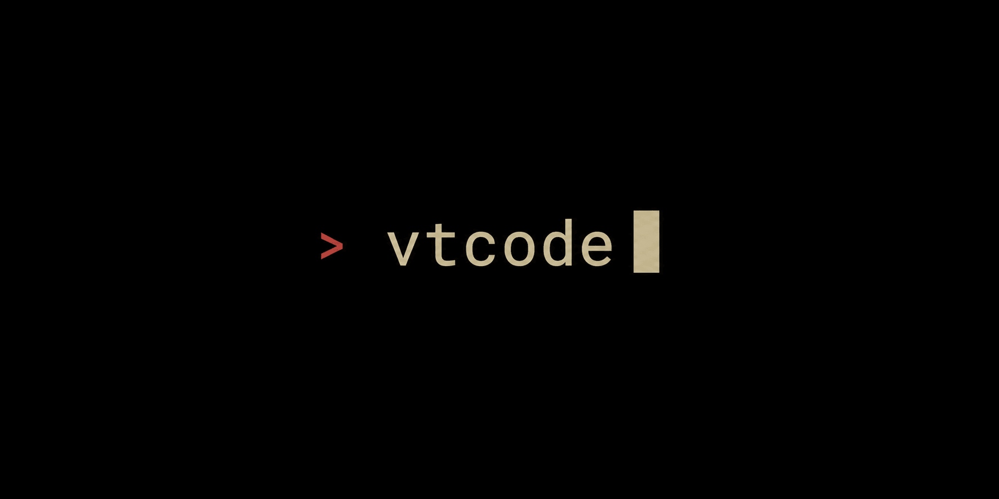

# VT Code Companion



Experimental local plugin source, version 0.1.1, by Vinh Nguyen. Start with the
[user setup and troubleshooting guide](../../docs/user-guide/vtcode-companion.md).
For the runtime contract and pilot evidence, see the
[implementation and setup guide](../../docs/development/vtcode-companion.md).

Display the product as **VT Code Companion**. Keep `vtcode-companion` as the
package/skill identifier and `vtcode` for the CLI. The square logo/composer icon
copies `resources/icons/vtcode-profile-512.png`; the supplied banner copies
`resources/logo/vtcode_5.png`. Both are included unchanged in the package. The
banner is branding artwork, not a screenshot proving a working host workflow.

The source includes a portable MCP config for GitHub marketplace installs. After
installing a compatible VT Code binary, select the exact executable and one
workspace with `vtcode --workspace /path/to/repository companion setup`. The
selection is saved in the user's private VT Code config and is independent of
the plugin cache and host working directory. Restart the MCP connection after
setup or whenever you change the selected workspace. To create an explicit-path
fallback package instead, run this from the repository root:

```sh
python3 scripts/package-vtcode-companion.py --local \
  --binary "$PWD/target/debug/vtcode" --workspace "$PWD" \
  --output "$PWD/target/vtcode-companion-local-0.1.1.zip"
```

The ZIP binds that exact binary and workspace. It requires Python 3 and a VT
Code build containing `webmcp stdio --companion`; it is a private
machine-specific artifact, not a portable public installer. The optional
remote packaging mode instead verifies the actual HTTPS endpoint and external
OAuth contract.

Installation, account upload, public submission, and publication are separate
actions. The host starts the configured MCP process when connected; packaging
does not install the plugin, establish trust, configure credentials, or deploy
a service. See [submission readiness](../../docs/development/vtcode-companion-submission.md)
for the remaining public-release requirements. A valid local ZIP is not a
submission-ready release.
